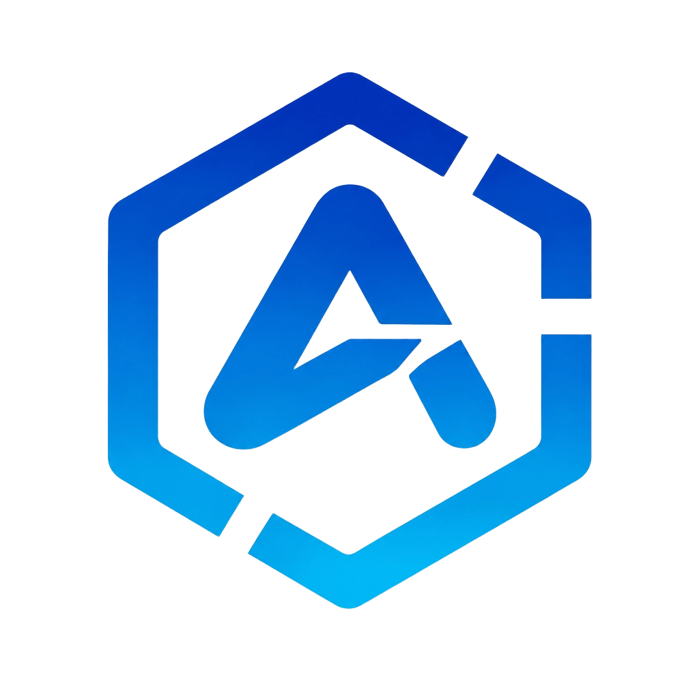
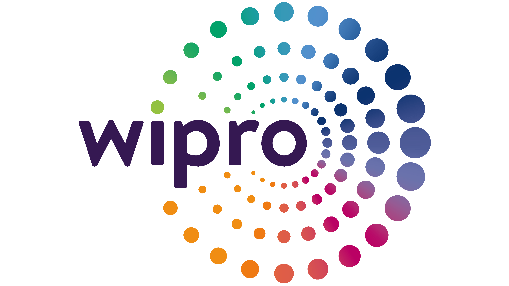
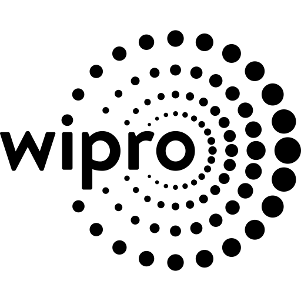
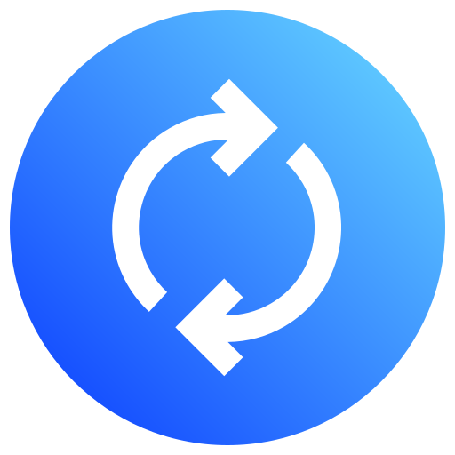
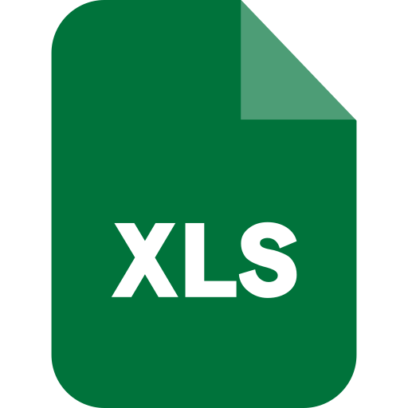

# Assets


Centralized asset repository for personal and enterprise project development (`AuditX Pro`, `AVSA Tech`, and web portals).

---

## 📦 Repository Asset Index

> **Auto-Sync Enabled:** This index updates automatically via GitHub Actions whenever files are added, renamed, or deleted. Use **jsDelivr CDN** links in production web apps and WPF clients, and **Raw URLs** for direct testing.

<!-- ASSETS-START -->
### 🎯 Icons & Logos

| Name & Path | Preview | CDN Link (`jsDelivr`) | Direct Raw |
| :--- | :---: | :--- | :---: |
| `Logo-icons/AVSA V3 icon.ico` |  | `https://cdn.jsdelivr.net/gh/A-Trident/Assets@main/Logo-icons/AVSA%20V3%20icon.ico` | [Raw](https://raw.githubusercontent.com/A-Trident/Assets/main/Logo-icons/AVSA%20V3%20icon.ico) |
| `Logo-icons/AVSA V3 logo.png` |  | `https://cdn.jsdelivr.net/gh/A-Trident/Assets@main/Logo-icons/AVSA%20V3%20logo.png` | [Raw](https://raw.githubusercontent.com/A-Trident/Assets/main/Logo-icons/AVSA%20V3%20logo.png) |
| `Logo-icons/BITS-PILANI.ico` |  | `https://cdn.jsdelivr.net/gh/A-Trident/Assets@main/Logo-icons/BITS-PILANI.ico` | [Raw](https://raw.githubusercontent.com/A-Trident/Assets/main/Logo-icons/BITS-PILANI.ico) |
| `Logo-icons/Wipro-logo.ico` |  | `https://cdn.jsdelivr.net/gh/A-Trident/Assets@main/Logo-icons/Wipro-logo.ico` | [Raw](https://raw.githubusercontent.com/A-Trident/Assets/main/Logo-icons/Wipro-logo.ico) |
| `Logo-icons/Wipro.ico` |  | `https://cdn.jsdelivr.net/gh/A-Trident/Assets@main/Logo-icons/Wipro.ico` | [Raw](https://raw.githubusercontent.com/A-Trident/Assets/main/Logo-icons/Wipro.ico) |
| `Logo-icons/about.png` |  | `https://cdn.jsdelivr.net/gh/A-Trident/Assets@main/Logo-icons/about.png` | [Raw](https://raw.githubusercontent.com/A-Trident/Assets/main/Logo-icons/about.png) |
| `Logo-icons/android.ico` |  | `https://cdn.jsdelivr.net/gh/A-Trident/Assets@main/Logo-icons/android.ico` | [Raw](https://raw.githubusercontent.com/A-Trident/Assets/main/Logo-icons/android.ico) |
| `Logo-icons/app.png` |  | `https://cdn.jsdelivr.net/gh/A-Trident/Assets@main/Logo-icons/app.png` | [Raw](https://raw.githubusercontent.com/A-Trident/Assets/main/Logo-icons/app.png) |
| `Logo-icons/applications.ico` |  | `https://cdn.jsdelivr.net/gh/A-Trident/Assets@main/Logo-icons/applications.ico` | [Raw](https://raw.githubusercontent.com/A-Trident/Assets/main/Logo-icons/applications.ico) |
| `Logo-icons/authentication.png` |  | `https://cdn.jsdelivr.net/gh/A-Trident/Assets@main/Logo-icons/authentication.png` | [Raw](https://raw.githubusercontent.com/A-Trident/Assets/main/Logo-icons/authentication.png) |
| `Logo-icons/cisco.ico` |  | `https://cdn.jsdelivr.net/gh/A-Trident/Assets@main/Logo-icons/cisco.ico` | [Raw](https://raw.githubusercontent.com/A-Trident/Assets/main/Logo-icons/cisco.ico) |
| `Logo-icons/cloud-computing.ico` |  | `https://cdn.jsdelivr.net/gh/A-Trident/Assets@main/Logo-icons/cloud-computing.ico` | [Raw](https://raw.githubusercontent.com/A-Trident/Assets/main/Logo-icons/cloud-computing.ico) |
| `Logo-icons/data-server.ico` |  | `https://cdn.jsdelivr.net/gh/A-Trident/Assets@main/Logo-icons/data-server.ico` | [Raw](https://raw.githubusercontent.com/A-Trident/Assets/main/Logo-icons/data-server.ico) |
| `Logo-icons/development.ico` |  | `https://cdn.jsdelivr.net/gh/A-Trident/Assets@main/Logo-icons/development.ico` | [Raw](https://raw.githubusercontent.com/A-Trident/Assets/main/Logo-icons/development.ico) |
| `Logo-icons/eclipse.ico` |  | `https://cdn.jsdelivr.net/gh/A-Trident/Assets@main/Logo-icons/eclipse.ico` | [Raw](https://raw.githubusercontent.com/A-Trident/Assets/main/Logo-icons/eclipse.ico) |
| `Logo-icons/error-log.png` |  | `https://cdn.jsdelivr.net/gh/A-Trident/Assets@main/Logo-icons/error-log.png` | [Raw](https://raw.githubusercontent.com/A-Trident/Assets/main/Logo-icons/error-log.png) |
| `Logo-icons/folders docs.ico` |  | `https://cdn.jsdelivr.net/gh/A-Trident/Assets@main/Logo-icons/folders%20docs.ico` | [Raw](https://raw.githubusercontent.com/A-Trident/Assets/main/Logo-icons/folders%20docs.ico) |
| `Logo-icons/git.ico` |  | `https://cdn.jsdelivr.net/gh/A-Trident/Assets@main/Logo-icons/git.ico` | [Raw](https://raw.githubusercontent.com/A-Trident/Assets/main/Logo-icons/git.ico) |
| `Logo-icons/help.png` |  | `https://cdn.jsdelivr.net/gh/A-Trident/Assets@main/Logo-icons/help.png` | [Raw](https://raw.githubusercontent.com/A-Trident/Assets/main/Logo-icons/help.png) |
| `Logo-icons/icon.ico` |  | `https://cdn.jsdelivr.net/gh/A-Trident/Assets@main/Logo-icons/icon.ico` | [Raw](https://raw.githubusercontent.com/A-Trident/Assets/main/Logo-icons/icon.ico) |
| `Logo-icons/image.ico` |  | `https://cdn.jsdelivr.net/gh/A-Trident/Assets@main/Logo-icons/image.ico` | [Raw](https://raw.githubusercontent.com/A-Trident/Assets/main/Logo-icons/image.ico) |
| `Logo-icons/info.png` |  | `https://cdn.jsdelivr.net/gh/A-Trident/Assets@main/Logo-icons/info.png` | [Raw](https://raw.githubusercontent.com/A-Trident/Assets/main/Logo-icons/info.png) |
| `Logo-icons/instagram.ico` |  | `https://cdn.jsdelivr.net/gh/A-Trident/Assets@main/Logo-icons/instagram.ico` | [Raw](https://raw.githubusercontent.com/A-Trident/Assets/main/Logo-icons/instagram.ico) |
| `Logo-icons/loop.png` |  | `https://cdn.jsdelivr.net/gh/A-Trident/Assets@main/Logo-icons/loop.png` | [Raw](https://raw.githubusercontent.com/A-Trident/Assets/main/Logo-icons/loop.png) |
| `Logo-icons/menu-bar.png` |  | `https://cdn.jsdelivr.net/gh/A-Trident/Assets@main/Logo-icons/menu-bar.png` | [Raw](https://raw.githubusercontent.com/A-Trident/Assets/main/Logo-icons/menu-bar.png) |
| `Logo-icons/nodejs.ico` |  | `https://cdn.jsdelivr.net/gh/A-Trident/Assets@main/Logo-icons/nodejs.ico` | [Raw](https://raw.githubusercontent.com/A-Trident/Assets/main/Logo-icons/nodejs.ico) |
| `Logo-icons/sap.ico` |  | `https://cdn.jsdelivr.net/gh/A-Trident/Assets@main/Logo-icons/sap.ico` | [Raw](https://raw.githubusercontent.com/A-Trident/Assets/main/Logo-icons/sap.ico) |
| `Logo-icons/torrent-file.ico` |  | `https://cdn.jsdelivr.net/gh/A-Trident/Assets@main/Logo-icons/torrent-file.ico` | [Raw](https://raw.githubusercontent.com/A-Trident/Assets/main/Logo-icons/torrent-file.ico) |
| `Logo-icons/videos.ico` |  | `https://cdn.jsdelivr.net/gh/A-Trident/Assets@main/Logo-icons/videos.ico` | [Raw](https://raw.githubusercontent.com/A-Trident/Assets/main/Logo-icons/videos.ico) |
| `Logo-icons/web-development.ico` |  | `https://cdn.jsdelivr.net/gh/A-Trident/Assets@main/Logo-icons/web-development.ico` | [Raw](https://raw.githubusercontent.com/A-Trident/Assets/main/Logo-icons/web-development.ico) |
| `Logo-icons/IMG/csv.png` |  | `https://cdn.jsdelivr.net/gh/A-Trident/Assets@main/Logo-icons/IMG/csv.png` | [Raw](https://raw.githubusercontent.com/A-Trident/Assets/main/Logo-icons/IMG/csv.png) |
| `Logo-icons/IMG/exit.png` |  | `https://cdn.jsdelivr.net/gh/A-Trident/Assets@main/Logo-icons/IMG/exit.png` | [Raw](https://raw.githubusercontent.com/A-Trident/Assets/main/Logo-icons/IMG/exit.png) |
| `Logo-icons/IMG/help.png` |  | `https://cdn.jsdelivr.net/gh/A-Trident/Assets@main/Logo-icons/IMG/help.png` | [Raw](https://raw.githubusercontent.com/A-Trident/Assets/main/Logo-icons/IMG/help.png) |
| `Logo-icons/IMG/manage-tcode.png` |  | `https://cdn.jsdelivr.net/gh/A-Trident/Assets@main/Logo-icons/IMG/manage-tcode.png` | [Raw](https://raw.githubusercontent.com/A-Trident/Assets/main/Logo-icons/IMG/manage-tcode.png) |
| `Logo-icons/IMG/system-setting.png` |  | `https://cdn.jsdelivr.net/gh/A-Trident/Assets@main/Logo-icons/IMG/system-setting.png` | [Raw](https://raw.githubusercontent.com/A-Trident/Assets/main/Logo-icons/IMG/system-setting.png) |
| `Logo-icons/IMG/xls.png` |  | `https://cdn.jsdelivr.net/gh/A-Trident/Assets@main/Logo-icons/IMG/xls.png` | [Raw](https://raw.githubusercontent.com/A-Trident/Assets/main/Logo-icons/IMG/xls.png) |

### 🎨 Backgrounds & Wallpapers

| Name & Path | Preview | CDN Link (`jsDelivr`) | Direct Raw |
| :--- | :---: | :--- | :---: |
| `Logo-icons/infinite-removebg-preview.ico` |  | `https://cdn.jsdelivr.net/gh/A-Trident/Assets@main/Logo-icons/infinite-removebg-preview.ico` | [Raw](https://raw.githubusercontent.com/A-Trident/Assets/main/Logo-icons/infinite-removebg-preview.ico) |

### 📦 Software, Libraries & Other Files

| Name & Path | Preview | CDN Link (`jsDelivr`) | Direct Raw |
| :--- | :---: | :--- | :---: |
| `SAP .NET Connector X64/NCo31APIDocumentation.chm` | — | `https://cdn.jsdelivr.net/gh/A-Trident/Assets@main/SAP%20.NET%20Connector%20X64/NCo31APIDocumentation.chm` | [Raw](https://raw.githubusercontent.com/A-Trident/Assets/main/SAP%20.NET%20Connector%20X64/NCo31APIDocumentation.chm) |
| `SAP .NET Connector X64/NCo31APIDocumentation.chw` | — | `https://cdn.jsdelivr.net/gh/A-Trident/Assets@main/SAP%20.NET%20Connector%20X64/NCo31APIDocumentation.chw` | [Raw](https://raw.githubusercontent.com/A-Trident/Assets/main/SAP%20.NET%20Connector%20X64/NCo31APIDocumentation.chw) |
| `SAP .NET Connector X64/licenses.txt` | — | `https://cdn.jsdelivr.net/gh/A-Trident/Assets@main/SAP%20.NET%20Connector%20X64/licenses.txt` | [Raw](https://raw.githubusercontent.com/A-Trident/Assets/main/SAP%20.NET%20Connector%20X64/licenses.txt) |
| `SAP .NET Connector X64/release_notes.txt` | — | `https://cdn.jsdelivr.net/gh/A-Trident/Assets@main/SAP%20.NET%20Connector%20X64/release_notes.txt` | [Raw](https://raw.githubusercontent.com/A-Trident/Assets/main/SAP%20.NET%20Connector%20X64/release_notes.txt) |
| `SAP .NET Connector X64/sapnco.dll` | — | `https://cdn.jsdelivr.net/gh/A-Trident/Assets@main/SAP%20.NET%20Connector%20X64/sapnco.dll` | [Raw](https://raw.githubusercontent.com/A-Trident/Assets/main/SAP%20.NET%20Connector%20X64/sapnco.dll) |
<!-- ASSETS-END -->

---

## 🔐 Self-Signed Code Signing Certificate (`AuditX Pro`)

Run these scripts in an **Administrator PowerShell** session to generate a local code-signing certificate, establish machine trust, and sign the `AuditX.exe` binary.

### Step 1: Generate & Trust the Certificate

Run once on your build machine to create a 5-year RSA 2048-bit code-signing certificate and register it in the local trust stores:

```powershell
# 1. Create output directory if it does not exist
$certDir = "D:\Certificate"
if (-not (Test-Path $certDir)) { New-Item -ItemType Directory -Path $certDir | Out-Null }

# 2. Generate the Code Signing Certificate and capture the object dynamically
$cert = New-SelfSignedCertificate `
    -Type CodeSigningCert `
    -Subject "CN=AuditX Pro, O=AVSA Tech Consulting" `
    -KeyAlgorithm RSA `
    -KeyLength 2048 `
    -CertStoreLocation "Cert:\LocalMachine\My" `
    -NotAfter (Get-Date).AddYears(5) `
    -FriendlyName "AuditX Pro Code Signing"

Write-Host "Generated Certificate Thumbprint: $($cert.Thumbprint)" -ForegroundColor Cyan

# 3. Export the public certificate (.cer)
$cerPath = "$certDir\AuditX.cer"
Export-Certificate -Cert $cert -FilePath$cerPath -Force | Out-Null

# 4. Import into Trusted Root Certification Authorities (Prevents "Untrusted Root" errors)
Import-Certificate -FilePath $cerPath -CertStoreLocation "Cert:\LocalMachine\Root" | Out-Null

# 5. Import into Trusted Publishers (Allows silent execution without SmartScreen publisher warnings)
Import-Certificate -FilePath $cerPath -CertStoreLocation "Cert:\LocalMachine\TrustedPublisher" | Out-Null

Write-Host "Certificate successfully installed in Root and TrustedPublisher stores." -ForegroundColor Green
```

### Step 2: Sign the `AuditX.exe` Executable

Run during your release build process to apply a SHA-256 Authenticode signature with an RFC 3161 timestamp (keeping the signature valid even after the certificate expires):

```powershell
$exePath = "D:\2. Workspace\AuditX\RS Group\Release\3.0.0.1\AuditX.exe"

# Retrieve the latest AuditX Pro certificate automatically by FriendlyName
$signingCert = Get-ChildItem "Cert:\LocalMachine\My" |
    Where-Object { $_.FriendlyName -eq "AuditX Pro Code Signing" } |
    Sort-Object NotAfter -Descending |
    Select-Object -First 1

if ($null -eq$signingCert) {
    throw "AuditX Pro signing certificate not found in Cert:\LocalMachine\My."
}

# Apply Authenticode signature with SHA-256 hash and RFC 3161 timestamp
Set-AuthenticodeSignature `
    -FilePath $exePath `
    -Certificate $signingCert `
    -HashAlgorithm SHA256 `
    -TimestampServer "http://timestamp.digicert.com"

# Verify the applied signature
Get-AuthenticodeSignature -FilePath $exePath | Format-List Status, StatusMessage, SignerCertificate
```

<details>
<summary><b>Step 3: Export Private Key Backup (.pfx) (Optional)</b></summary>
<br>

Use this snippet to back up the certificate and private key before migrating to a new development machine or CI/CD runner:

```powershell
$pfxPassword = ConvertTo-SecureString -String "ChangeThisStrongPassword!" -Force -AsPlainText
Export-PfxCertificate `
    -Cert $signingCert `
    -FilePath "D:\Certificate\AuditX_PrivateBackup.pfx" `
    -Password $pfxPassword
```

</details>
